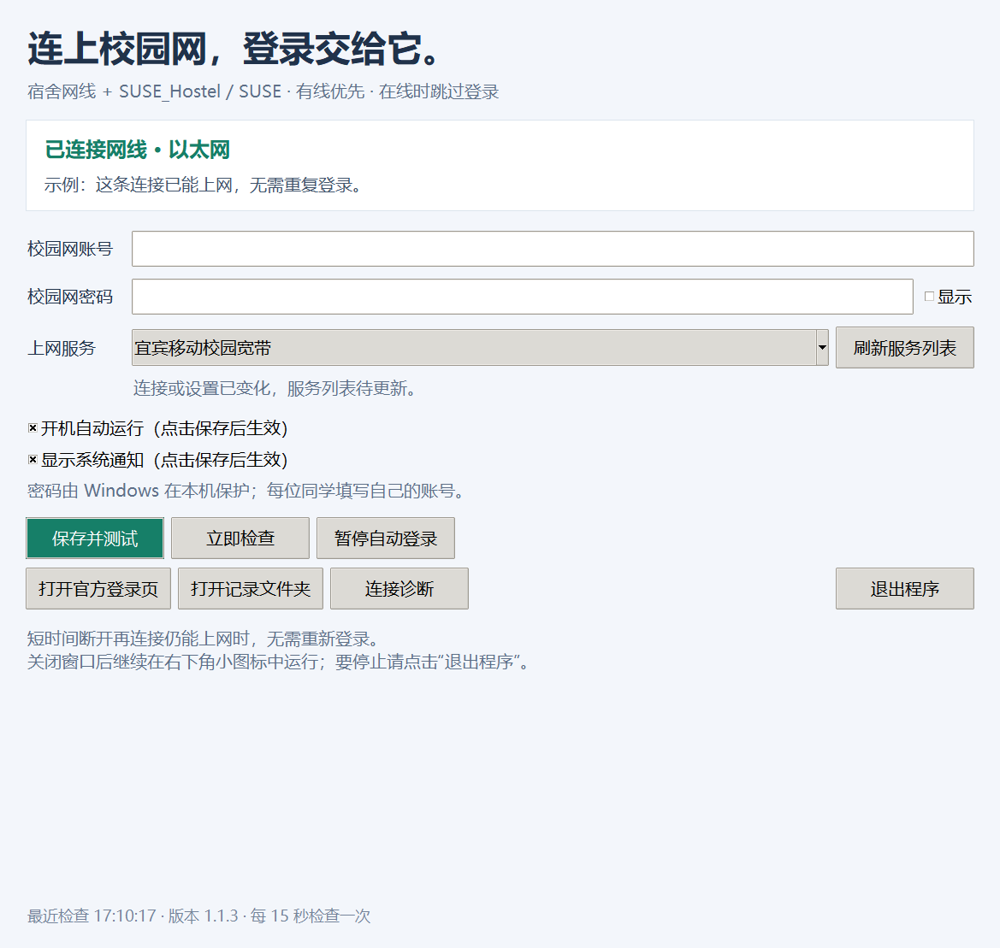

# SUSE Campus Login — Windows 1.1.3

[中文](README.md) | **English**

An unofficial campus network login helper for the **Yibin campus of Sichuan University of Science & Engineering**. Supports dormitory Ethernet, including USB Ethernet adapters, and campus Wi-Fi named `SUSE_Hostel` or `SUSE` on **64-bit Windows 10/11**. “SUSE” here is the campus Wi-Fi name.

The application checks connectivity first and signs in only when it detects a recognized campus authentication redirect. It does not sign in again while the selected connection can already access the internet.

**The application interface and the original instructions inside the ZIP are in Chinese.** This repository offers Chinese and English reading guides; it does not add an English interface to the application. Android and iPad versions are not available.

## Download and start

- [Latest release](https://github.com/tsiskjsjs532-hash/suse-campus-login/releases/latest)
- [Download the complete Windows v1.1.3 ZIP](https://github.com/tsiskjsjs532-hash/suse-campus-login/releases/download/v1.1.3/SUSE-CampusLogin-Windows-v1.1.3.zip)
- [Release notes: 中文 / English](docs/releases/v1.1.3.md)
- [Original illustrated instructions — Chinese](docs/使用说明.html)

1. Download **`SUSE-CampusLogin-Windows-v1.1.3.zip`** from the release assets. GitHub's automatically generated “Source code” archives contain development files, not the ready-to-run application.
2. Extract the entire ZIP to a permanent folder, then open `CampusLogin.exe`. Python and administrator privileges are not required to run it.
3. Connect dormitory Ethernet or campus Wi-Fi, enter your own campus account and password, and choose the service matching your operator and plan.
4. When a supported campus authentication redirect is detected, the current service list loads automatically. **“刷新服务列表” (Refresh service list)** only reads options; it does not submit credentials and also works while automatic login is paused.
5. Click **“保存并测试” (Save and test)**. The startup and notification options take effect after saving. If you are already online, skipping login is expected and does not verify your password.

Closing the window leaves the application running in the notification area. Use **“打开设置” (Open settings)** to reopen it or **“退出程序” (Exit)** to stop it. Exiting does not log out your campus session.



## Features and safeguards

| Version | Improvements |
| --- | --- |
| 1.1.0 | Ethernet and USB Ethernet support; wired priority; separate checks, authentication and verification per adapter. |
| 1.1.1 | Wireless interface fault isolation; multiple campus Wi-Fi adapters handled independently; virtual Ethernet adapters excluded. |
| 1.1.2 | Windows notifications, a persistent notification switch, and duplicate suppression. Routine checks and temporary retries remain silent. |
| 1.1.3 | Live campus service lists, read-only refresh, exact service matching, and persistent support for new service names. |

- A service must exactly match a unique, available entry in the current list. Renamed services require you to choose and save again; the app never guesses by operator keywords or silently selects the first entry.
- Identical duplicate entries are merged; conflicting, hidden, or extra-information services are not used automatically. Old results are invalidated when connections, addresses or settings change.
- If you are already online, the app may be unable to obtain a fresh authentication redirect. It retains your selection and reports that the list cannot currently be updated. Do not disconnect or log out just to refresh it.
- Each connection uses an independent session bound to its adapter and source IPv4 address. Wired checks take priority; an uncertain wired result may fall back to campus Wi-Fi. A failed authentication does not trigger credential submissions across other adapters.
- Only a recognized campus authentication host and path with complete current connection parameters allow authentication. Unknown pages, timeouts, unrelated Wi-Fi and incomplete redirects do not trigger credential submission.
- The current confirmed portal host is `10.23.2.4`, under `/eportal/index.jsp`. Authentication follows `pageInfo → getServices → login`, retaining the campus page's existing password encoding and encryption compatibility.
- Normal internet checks are scheduled every 15 seconds. Temporary failures retry after 5, 15 and 30 seconds, followed by a five-minute wait. Credential rejection stops automatic submissions until settings are saved.
- The app does not disconnect networks, change routes or log out another connection. The recognized campus-only service does not imply internet access. If a new service is accepted but internet verification fails, the app requests manual confirmation instead of repeatedly submitting credentials.
- Success notifications require connectivity verification. Repeated failures are suppressed; notification delivery, duration and sound are controlled by Windows.

## Common actions and upgrading

| Action | Chinese control / instructions |
| --- | --- |
| Check now | **立即检查**; resumes automatic login if paused. |
| Pause / resume | **暂停自动登录 / 恢复自动登录**. |
| Refresh service options | **刷新服务列表**; read-only, preserves credential-error protection. Select a service and save before it takes effect. |
| Diagnose a connection | **连接诊断**; no credential submission. Copy the report, rather than a full portal URL or network capture. |
| Open the official page | **打开官方登录页**; use it for CAPTCHA, account restrictions or unsupported authentication. |
| Disable notifications or startup | Clear the corresponding checkbox and click **保存并测试**. |

To upgrade, exit the old tray application, extract the complete new ZIP to a permanent location, and open the new executable. Existing settings are retained. If you use startup, save once from the new version to update its startup path. Keep the old local folder for rollback. Earlier applications accept only fixed service names and may require you to re-enter settings or select an older supported service after a downgrade.

## Privacy and verification limits

Each user enters their own account. Settings are stored in `%LOCALAPPDATA%\SUSECampusLogin`, outside the application folder. The username is stored as text; the password is protected locally by Windows DPAPI. DPAPI protects saved data and is not a replacement for transport encryption: the campus portal uses HTTP and its existing legacy password format.

Logs contain fixed state codes, not credentials, complete authentication URLs or device parameter values, and rotate to approximately 384 KB total. Notifications use fixed messages rather than raw server responses. Do not share your personal settings directory, password or unredacted account screenshots. Example images and tests use empty or synthetic data. Source commits use a GitHub privacy email.

**135 automated tests passed** on November 11, 2026: 90 existing tests and 45 service-related additions. Five additional synthetic UI layout scenarios were checked. ZIP integrity, AMD64 architecture, checksums and isolated extracted-application startup passed. Historical local releases were preserved.

An older dormitory Wi-Fi version was confirmed working by the user. Version 1.1.3 authentication tests use synthetic data; real renamed-service login, dormitory Ethernet, classroom networks, hotspot/multiple-adapter combinations, sleep/resume and another PC without Python still require field verification. An isolated startup check on the same PC does not replace those tests. See the [detailed verification record — Chinese](docs/验证记录.md).

## Development and project structure

Development uses 64-bit Python 3.13 on Windows; the current build environment uses Python 3.13.7.

```powershell
python -m venv .venv
.\.venv\Scripts\python.exe -m pip install -r requirements-build.txt
.\.venv\Scripts\python.exe -m unittest discover -s tests -v
.\.venv\Scripts\python.exe main.py
```

- Read-only diagnosis: `.\.venv\Scripts\python.exe -X utf8 main.py --diagnose`.
- Blank example window: `.\.venv\Scripts\python.exe main.py --ui-check`; does not load personal settings, sign in or save settings, and exits after eight seconds.
- Example window capture: `.\.venv\Scripts\python.exe tools\verify_ui.py --service-cases`; updates the documentation screenshot and writes additional synthetic images under `build/`.
- Synthetic notification demo: `.\.venv\Scripts\python.exe -X utf8 tools\demo_notifications.py --auto`; no personal settings or network access.
- Build: `./build.ps1`, or `.\.venv\Scripts\python.exe -X utf8 tools\package_release.py` after installing the build dependencies. Dependencies are pinned in [requirements-lock.txt](requirements-lock.txt).
- Local release verification: `.\.venv\Scripts\python.exe -X utf8 tools\verify_release.py`. **This script requires the locally retained historical packages and `.cache` checksum baselines, which are not included in this public source repository.** A fresh clone can run the unit tests and build the current application, but cannot perform the complete historical comparison without those files.

| Module | Purpose |
| --- | --- |
| `adapters.py`, `windows.py`, `transport.py` | Windows adapter discovery, local password protection, startup, single-instance behavior and interface-bound requests. |
| `network.py`, `portal.py`, `engine.py` | Connectivity and trusted-redirect detection, service lists, authentication, verification, retries and cancellation. |
| `models.py`, `storage.py`, `gui.py`, `notifications.py` | Data types, local settings and logs, Chinese settings window, tray and notifications. |
| `tests/`, `tools/`, `docs/` | Automated regression tests, packaging/verification tools and instructions. |

The next development candidates are adaptive check intervals and a dedicated domestic backup connectivity endpoint. Neither is implemented in 1.1.3. Field verification remains a priority.

This is not an official university client and does not bypass account, billing or device limits. Third-party notices remain in [THIRD_PARTY_NOTICES.md](THIRD_PARTY_NOTICES.md); the full ZIP contains the bundled license texts and pystray source. No new project license is added by this publication.
