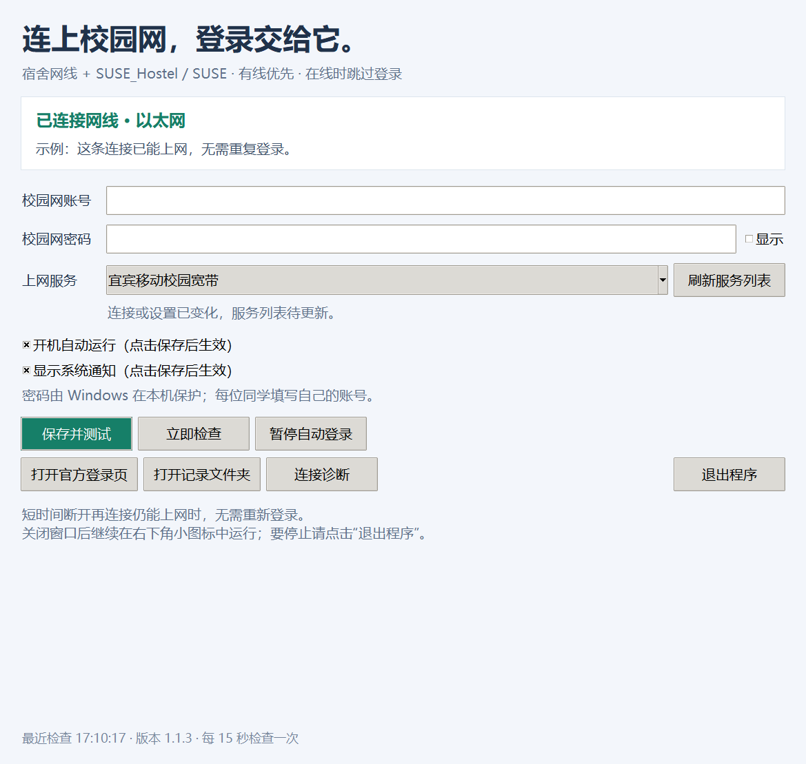

# SUSE 校园网自动登录

**中文** | [English](README.en.md)

连上校园网，登录交给它。

面向**四川轻化工大学宜宾校区**，提供 Android、Windows、Mac 和 iOS 版本。

## Android 版

支持 **Android 10 及以上**手机和平板，适配 `SUSE`、`SUSE_Hostel` 校园 Wi-Fi。

**[下载 Android 0.4.2](https://github.com/TheMingverse/suse-campus-login/releases/download/android-v0.4.2/SUSE-CampusLogin-Android-v0.4.2-release.apk)** · [更新说明](docs/releases/android-v0.4.2.md) · [Android 使用说明](android/README.md)

- **首次配置教程**：图文引导填写账号、选择运营商和添加快捷入口，随时可从首页顶部重看。
- **快捷登录**：支持控制中心“SUSE 登录”磁贴及桌面小组件。
- **按需认证**：打开 App 或点击快捷入口时检查校园网，需要认证时登录。
- **应用内更新**：打开或回到首页时检查新版，确认后下载并安装。

连接尚未登录认证的校园 Wi-Fi，按教程填写账号密码，刷新并选择上网服务后保存。已经能上网时，可先保存账号草稿，等下次需要认证时补全。建议开启校园 Wi-Fi 的“自动连接”，搭配登录磁贴使用。

已有正式版可直接覆盖安装，保留配置。

## Windows 版

支持 **Windows 10/11 64 位**，可使用校园网线（含 USB 转网口）或校园 Wi-Fi。

**[下载 Windows 版](https://github.com/TheMingverse/suse-campus-login/releases/latest)** · [v1.1.3 更新说明](docs/releases/v1.1.3.md)

### 开始使用

1. 下载 `SUSE-CampusLogin-Windows-v1.1.3.zip`，完整解压到固定文件夹，双击 `CampusLogin.exe`。
2. 插好校园网线或连接校园 Wi-Fi，填写自己的校园网账号、密码，选择对应的上网服务。
3. 点击 **“保存并测试”**。以后保持程序运行，需要认证时会自动登录。

密码由 Windows 在本机保护。

### 日常使用

- **自动登录**：需要认证时登录，已经在线时跳过。
- **网线优先**：同时连接网线和校园 Wi-Fi 时，优先检查网线。
- **服务列表**：自动获取学校当前服务，名称变化后重新选择并保存。
- **后台运行**：关闭窗口后继续在右下角托盘运行，可设置开机启动。
- **系统通知**：连接成功或需要处理时提醒，可在设置中关闭。

| 你想做什么 | 操作 |
| --- | --- |
| 打开设置 | 右键右下角小图标 →“打开设置”；图标可能收在向上箭头里 |
| 马上检查 | 点击“立即检查” |
| 暂停或恢复 | 点击“暂停自动登录 / 恢复自动登录” |
| 修改账号、服务或通知选项 | 修改后点击“保存并测试” |
| 更新服务列表 | 点击“刷新服务列表”，选择后保存 |
| 完全退出 | 点击“退出程序”，或从托盘菜单退出 |

### 常见问题

| 现象 | 操作 |
| --- | --- |
| 当前已在线，暂无法刷新服务列表 | 保留原选择，等下次需要登录时更新即可 |
| 账号或密码未通过认证 | 检查账号、密码和上网服务，再点击“保存并测试”；需手动处理时打开官方登录页 |
| 开机后没有自动运行 | 勾选“开机自动运行”并保存；检查任务管理器中的启动应用是否启用 |
| 其他连接问题 | 点击“连接诊断”，将复制的报告和窗口提示发到 [Issues](https://github.com/TheMingverse/suse-campus-login/issues) |

反馈时附上校区、Windows 版本和连接方式，请不要发送密码，截图遮住账号。

### 升级

先从右下角托盘退出旧程序，再解压并打开新版，原设置会继续沿用。使用开机启动的同学，请在新版点击一次“保存并测试”更新启动位置，之后保持程序文件夹位置不变。

[图文使用说明](docs/使用说明.html) · [开发与维护](docs/development.md)

## Mac 测试版

支持 macOS 15 及以上，提供 Apple 芯片和 Intel 两种版本。

[下载 Mac 测试版](https://github.com/TheMingverse/suse-campus-login/releases/tag/v1.2.0-macos-beta.1)

打开下载的 DMG，将 `SUSECampusLogin.app` 拖到“应用程序”，打开后填写账号、选择服务并保存。读取校园 Wi-Fi 名称时，请允许定位服务；关闭窗口后，可从顶部菜单栏重新打开设置。

[Mac 使用说明](docs/macos.md)

## iOS 版（测试中）

支持 **iOS 17 及以上**，用 SwiftUI 编写，协议与 Android、Mac 版共用同一套逻辑。

`ios/` 目录是自包含的 Xcode 工程说明：用 [XcodeGen](https://github.com/yonaskolb/XcodeGen) 生成工程，`xcodebuild test` 跑回归测试，GitHub Actions 会构建一个**未签名**的 `.ipa` 供自签工具安装。

iOS 无法读取 Wi-Fi 名称，因此改用“所有请求只走 Wi-Fi + 门户探测”判断是否在校园网内；首次登录时系统会询问是否允许访问本地网络，请选择允许。

[iOS 使用与开发说明](ios/README.md)

非学校官方工具。
